# Awesome AI Context Engineering & Agent Tools 🧠⚡

<p align="center">
  
</p>

<p align="center">
  <a href="https://github.com/ishandutta2007/Awesome-Awesome-Awesome"></a>
  <a href="https://discord.gg/jc4xtF58Ve"></a>
  <a href="https://github.com/ishandutta2007/Awesome-AI-Context-Engineering-Agent-Tools/stargazers"></a>
  <a href="https://github.com/ishandutta2007/Awesome-AI-Context-Engineering-Agent-Tools/network/members"></a>
  <a href="https://github.com/ishandutta2007/Awesome-AI-Context-Engineering-Agent-Tools/blob/main/LICENSE"></a>
  <a href="https://github.com/ishandutta2007"></a>
</p>

---

## 🚀 The Definite Guide to AI Context Engineering, Agent Runtimes & LLM Observability

> **A rigorously curated, battle-tested directory of enterprise SaaS solutions and open-source developer tooling.**  
> *Empowering AI engineers, context architects, and agent builders to pack repository context, compress high-signal token prompts, trace multi-agent execution graphs, evaluate RAG context precision, and observe production LLMs.*

📅 **Last updated:** November 2026 | 🌟 **Category Leaders:** Langfuse, Repomix, LangSmith, Arize Phoenix, Context7 MCP, DSPy, Mem0, Ragas

---

## 📑 Table of Contents

- [🌐 Sector Overview & Market Dynamics](#-sector-overview--market-dynamics)
- [🏢 SaaS & Hosted Platforms](#-saashosted-platforms)
- [💻 Open-Source GitHub Projects](#-open-source-github-projects)
- [🛠️ Architectural Recipe: Sovereign Agent Context Stack](#-architectural-recipe-sovereign-agent-context-stack)
- [🤝 How to Contribute](#-how-to-contribute)
- [💖 Support & Sponsorship](#-support--sponsorship)
- [📈 Star History](#-star-history)
- [⚖️ Disclaimer & License](#️-disclaimer--license)

---

## 🌐 Sector Overview & Market Dynamics

The AI observability, context management, and evaluation market is currently estimated at approximately **$1.8B to $4.1B** and is projected to expand rapidly at an explosive **~23% to 35% CAGR** through 2030 (driven by the rapid expansion of RAG systems, context-aware coding assistants, and autonomous agent loops).

The sector is currently **moderately fragmented at the tooling and evaluation application layer**—with vibrant competition among specialized developer-tool startups creating novel prompt compression algorithms, context packs, and trace waterfall viewers. Concurrently, it is experiencing **rapid consolidation and concentration** toward dominant enterprise platforms and cloud hyperscalers acquiring pure-play observability leaders (e.g., CoreWeave acquiring Weights & Biases, Dynatrace acquiring Arize AI, and ServiceNow acquiring Traceloop).

---

## 🏢 SaaS/Hosted Platforms

| Platform | 🏢 Company Size (Valuation / Revenue) | 💳 Starting Price (Paid Tier) | 🎁 Free Tier / Free Trial Limits | 📋 Platform Overview |
| :--- | :--- | :--- | :--- | :--- |
| **[Weights & Biases Weave](https://wandb.ai)** | $1.7B acquisition valuation (by CoreWeave); ~$50M ARR (2024) | $60 / month (Pro plan; 1.5 GB data ingestion included) | Free forever plan: 1 GB/month Weave data ingestion (traces, evaluations, prompt calls); 30-day Pro trial available | Cloud developer toolkit from W&B for logging, tracing, visualizing, and evaluating LLM calls, retrieved context chunks, and multi-agent trajectories. |
| **[LangSmith (LangChain)](https://langchain.com)** | $1.25B–$1.3B valuation (Series B, 2025); ~$15M ARR | $39 / seat / month (Plus plan; 10,000 shared base traces/month included) | Free forever plan (Developer): 1 seat, 5,000 base traces/month, 14-day retention | All-in-one cloud platform for tracing, debugging, testing, and evaluating context flows, prompt templates, and stateful LangGraph agent runs. |
| **[Arize AX / Arize Phoenix Cloud](https://arize.com)** | $915M acquisition valuation (by Dynatrace, 2025); ~$10M–$50M ARR | $50 / month (AX Pro plan; ~50,000+ span volume) | Free forever plan (AX Free): 25,000 spans/month, 15-day data retention; unlimited for self-hosted OSS Phoenix | Enterprise AI observability and evaluation platform delivering OpenTelemetry span tracing, RAG context relevance diagnostics, and drift detection. |
| **[Braintrust](https://braintrust.dev)** | Venture-backed (Raised $80M Series B in 2026; backed by a16z / ICONIQ) | $249 / month (Pro plan; 5 GB data, 50k scores, $100 model credits) | Free forever plan (Starter): 1 GB processed data/month, 10,000 evaluation scores/month, 14-day retention, $10 model credits | Enterprise AI evaluation, prompt playground, and logging platform designed to benchmark context-engineering changes and prevent quality regressions. |
| **[Traceloop](https://traceloop.com)** | $60M–$80M acquisition valuation (by ServiceNow, 2026); $6.6M total funding raised | Custom / Enterprise quote (starting at volume scale >50k spans) | Free forever plan: 50,000 spans/month, up to 5 user seats, 24-hour data retention; 100% free unlimited OSS SDK (OpenLLMetry) | Managed OpenTelemetry-native LLM observability platform built on OpenLLMetry for real-time agent context tracing and hallucination guardrails. |
| **[Helicone](https://helicone.ai)** | $25M valuation (Y Combinator W23, $5M Seed round) | $79 / month (Pro plan; unlimited seats, 1,000 logs/min) | Free forever plan (Hobby): 10,000 requests/month, 1 GB storage, 1 seat, 7-day data retention | Proxy-based AI gateway and observability platform providing request logging, prompt caching, token/context cost attribution, and multi-provider routing. |
| **[HoneyHive](https://honeyhive.ai)** | Seed-stage ($7.4M total funding raised; Insight Partners Seed lead) | Custom / Usage-based Enterprise tiers (startup program discounts available) | Free forever plan (Developer): 10,000 events/month, up to 5 seats, 1 workspace, 30-day retention | AI observability and evaluation suite built for compounding agent reliability via production context curation, human feedback loops, and CI/CD regression gates. |
| **[Langfuse Cloud](https://langfuse.com)** | Seed-stage ($4.5M total funding raised; Lightspeed Seed lead / YC W23) | $29 / month (Core plan; 100,000 units/month included, unlimited users) | Free forever plan (Hobby): 50,000 usage units/month, up to 2 users, 30-day data access; 100% free unlimited self-hosted OSS | Managed cloud deployment of the open-source LLM engineering platform offering trace analytics, decoupled prompt/context management, datasets, and online agent evaluations. |
| **[Lunary](https://lunary.ai)** | Early-stage startup (accelerator-backed via Xpreneurs; private bootstrapped/seed scale) | $20 / user / month (Team plan; 50,000 events/month and 300 playground queries included) | No free forever plan & no free trial for new cloud workspaces (upfront paid subscription required; self-hosted community edition free) | Production LLM observability, prompt management, and user analytics platform tailored for multi-step AI agent workflows and B2B AI applications. |
| **[OpenLIT Cloud](https://openlit.io)** | Open-source community & bootstrapping scale (no institutional funding raised) | Custom / Enterprise quote (Cloud hosted preview; contact for details) | Open-source self-hosted edition: Free forever with unlimited spans, traces, and metrics under Apache 2.0 (managed cloud tier in preview) | Hosted OpenTelemetry-native observability and GPU/LLM monitoring platform tracking token consumption, vector DB retrieval latency, and agent spans. |

---

## 💻 Open-Source GitHub Projects

*Ranked strictly by GitHub Star Count (Descending). Each badge links directly to the project's stargazers community.*

| 🏆 Project & Star Badge | 📜 License | 🎯 Core Context Engineering & Agent Capabilities |
| :--- | :--- | :--- |
| **[MarkItDown (`microsoft/markitdown`)](https://github.com/microsoft/markitdown)**<br>[](https://github.com/microsoft/markitdown/stargazers) | `MIT` | Python engine for converting PDFs, Office docs (Word, Excel, PowerPoint), audio, and images into clean Markdown context optimized for LLMs. |
| **[LangChain (`langchain-ai/langchain`)](https://github.com/langchain-ai/langchain)**<br>[](https://github.com/langchain-ai/langchain/stargazers) | `MIT` | Foundational framework for composing multi-step agent graphs, context retrieval pipelines, prompt templates, and structured tool interactions. |
| **[Claude-Mem (`thedotmack/claude-mem`)](https://github.com/thedotmack/claude-mem)**<br>[](https://github.com/thedotmack/claude-mem/stargazers) | `Apache-2.0` | Persistent cross-session context engine for AI coding agents that captures working memory, task states, and project learnings across conversations. |
| **[RAGFlow (`infiniflow/ragflow`)](https://github.com/infiniflow/ragflow)**<br>[](https://github.com/infiniflow/ragflow/stargazers) | `Apache-2.0` | Agent-native RAG orchestration engine featuring deep document understanding, template-based chunking, and grounded context extraction. |
| **[MCP Reference Servers (`modelcontextprotocol/servers`)](https://github.com/modelcontextprotocol/servers)**<br>[](https://github.com/modelcontextprotocol/servers/stargazers) | `MIT` | Official reference implementations for the Model Context Protocol (MCP), exposing structured context from Git, PostgreSQL, Google Drive, and local filesystems. |
| **[Docling (`docling-project/docling`)](https://github.com/docling-project/docling)**<br>[](https://github.com/docling-project/docling/stargazers) | `MIT` | Advanced document parser parsing complex PDFs, formulas, tables, and multi-column layouts into high-fidelity context for RAG and agent ingestion. |
| **[Mem0 (`mem0ai/mem0`)](https://github.com/mem0ai/mem0)**<br>[](https://github.com/mem0ai/mem0/stargazers) | `Apache-2.0` | The memory layer for AI agents; provides self-improving personalization and dynamic long-term context retention across user interactions. |
| **[Context7 MCP (`upstash/context7`)](https://github.com/upstash/context7)**<br>[](https://github.com/upstash/context7/stargazers) | `MIT` | Model Context Protocol server that dynamically pulls up-to-date, versioned library documentation and syntax guides into coding agent windows. |
| **[LlamaIndex (`run-llama/llama_index`)](https://github.com/run-llama/llama_index)**<br>[](https://github.com/run-llama/llama_index/stargazers) | `MIT` | Leading data framework for LLMs providing advanced context indexers, semantic chunkers, vector store connectors, and agentic query engines. |
| **[DSPy (`stanfordnlp/dspy`)](https://github.com/stanfordnlp/dspy)**<br>[](https://github.com/stanfordnlp/dspy/stargazers) | `MIT` | Declarative framework from Stanford NLP for programmatically compiling and optimizing prompts, few-shot demonstrations, and context retrieval modules. |
| **[Langfuse (`langfuse/langfuse`)](https://github.com/langfuse/langfuse)**<br>[](https://github.com/langfuse/langfuse/stargazers) | `MIT / FSL` | Leading open-source LLM engineering platform for agent observability, context versioning, trace waterfalls, LLM cost tracking, and online evals. |
| **[Qdrant (`qdrant/qdrant`)](https://github.com/qdrant/qdrant)**<br>[](https://github.com/qdrant/qdrant/stargazers) | `Apache-2.0` | Ultra-fast vector database with rich payload filtering, ideal for semantic context retrieval, agent working memory, and hybrid keyword search. |
| **[Graphiti (`getzep/graphiti`)](https://github.com/getzep/graphiti)**<br>[](https://github.com/getzep/graphiti/stargazers) | `Apache-2.0` | Real-time knowledge graph framework for AI agents that maps dynamic entities, temporal relations, and episodic context facts over time. |
| **[Chroma (`chroma-core/chroma`)](https://github.com/chroma-core/chroma)**<br>[](https://github.com/chroma-core/chroma/stargazers) | `Apache-2.0` | Lightweight, open-source AI-native embedding database tailored for quick local prototyping of RAG context caches and agent short-term memory. |
| **[Repomix (`yamadashy/repomix`)](https://github.com/yamadashy/repomix)**<br>[](https://github.com/yamadashy/repomix/stargazers) | `MIT` | CLI and MCP tool that packs entire code repositories into compact, single-file XML, Markdown, or JSON context bundles with Tree-sitter compression. |
| **[Tree-sitter (`tree-sitter/tree-sitter`)](https://github.com/tree-sitter/tree-sitter)**<br>[](https://github.com/tree-sitter/tree-sitter/stargazers) | `MIT` | Fast, incremental parser generating concrete syntax trees; foundation for syntax-aware code context packing, symbol slicing, and smart chunking. |
| **[Promptfoo (`promptfoo/promptfoo`)](https://github.com/promptfoo/promptfoo)**<br>[](https://github.com/promptfoo/promptfoo/stargazers) | `MIT` | CLI & testing framework for prompt/context experimentation, automated red-teaming, hallucination assertions, and CI/CD quality gate enforcement. |
| **[Opik (`comet-ml/opik`)](https://github.com/comet-ml/opik)**<br>[](https://github.com/comet-ml/opik/stargazers) | `Apache-2.0` | Production LLM evaluation and observability tool from Comet designed to debug agent chains, trace RAG context retrieval, and run LLM-as-a-judge scores. |
| **[DeepEval (`confident-ai/deepeval`)](https://github.com/confident-ai/deepeval)**<br>[](https://github.com/confident-ai/deepeval/stargazers) | `Apache-2.0` | Comprehensive LLM evaluation suite measuring context relevancy, hallucination index, faithfulness, answer relevancy, and custom G-Eval criteria. |
| **[Ragas (`explodinggradients/ragas`)](https://github.com/explodinggradients/ragas)**<br>[](https://github.com/explodinggradients/ragas/stargazers) | `Apache-2.0` | Specialized evaluation framework calculating context precision, context recall, context entities recall, and factual groundedness for RAG pipelines. |
| **[Gitingest (`coderamp-labs/gitingest`)](https://github.com/coderamp-labs/gitingest)**<br>[](https://github.com/coderamp-labs/gitingest/stargazers) | `MIT` | Web utility and package that transforms any GitHub repository into an LLM-ready text digest with hierarchical file directory trees. |
| **[Arize Phoenix (`Arize-ai/phoenix`)](https://github.com/Arize-ai/phoenix)**<br>[](https://github.com/Arize-ai/phoenix/stargazers) | `ELv2` | OpenTelemetry-native AI observability platform providing span trace waterfalls, RAG retrieval context relevance inspection, and eval notebooks. |
| **[Code2Prompt (`mufeedvh/code2prompt`)](https://github.com/mufeedvh/code2prompt)**<br>[](https://github.com/mufeedvh/code2prompt/stargazers) | `MIT` | High-speed Rust CLI that compiles codebases into structured LLM prompts using Handlebars templating and `.gitignore` file filtering. |
| **[OpenLLMetry (`traceloop/openllmetry`)](https://github.com/traceloop/openllmetry)**<br>[](https://github.com/traceloop/openllmetry/stargazers) | `Apache-2.0` | Set of OpenTelemetry standard instrumentations for monitoring LLM calls, vector database lookups, and multi-agent frameworks with zero vendor lock-in. |
| **[LLMLingua (`microsoft/LLMLingua`)](https://github.com/microsoft/LLMLingua)**<br>[](https://github.com/microsoft/LLMLingua/stargazers) | `MIT` | Microsoft Research prompt compression library compressing long context prompts up to 20x while retaining high semantic reasoning fidelity. |
| **[Helicone (`Helicone/helicone`)](https://github.com/Helicone/helicone)**<br>[](https://github.com/Helicone/helicone/stargazers) | `Apache-2.0` | Open-source LLM proxy gateway enabling caching, rate limiting, request tracing, latency tracking, and cost analytics with a 1-line code drop-in. |
| **[dsh-context (`bowenliang123/dsh-context`)](https://github.com/bowenliang123/dsh-context)**<br>[](https://github.com/bowenliang123/dsh-context/stargazers) | `Apache-2.0` | Developer shell context utility designed for assembling, tokenizing, and formatting task context specifically for AI coding agents. |
| **[Agenta (`Agenta-AI/agenta`)](https://github.com/Agenta-AI/agenta)**<br>[](https://github.com/Agenta-AI/agenta/stargazers) | `Apache-2.0` | Developer workspace for building, prompt engineering, versioning, and rigorously evaluating agent workflows with human-in-the-loop annotations. |
| **[Chonkie (`chonkie-inc/chonkie`)](https://github.com/chonkie-inc/chonkie)**<br>[](https://github.com/chonkie-inc/chonkie/stargazers) | `MIT` | Lightweight, lightning-fast semantic and token chunking library designed specifically to prepare high-signal text chunks for RAG context windows. |
| **[Basic Memory (`basicmachines-co/basic-memory`)](https://github.com/basicmachines-co/basic-memory)**<br>[](https://github.com/basicmachines-co/basic-memory/stargazers) | `AGPL-3.0` | Local-first Markdown memory system empowering AI agents to store persistent context, recall prior project sessions, and never repeat queries. |
| **[TruLens (`truera/trulens`)](https://github.com/truera/trulens)**<br>[](https://github.com/truera/trulens/stargazers) | `MIT` | Evaluation and tracking library computing the "RAG Triad" (Context Relevance, Groundedness, and Answer Relevance) across agent feedback loops. |
| **[OpenLIT (`openlit/openlit`)](https://github.com/openlit/openlit)**<br>[](https://github.com/openlit/openlit/stargazers) | `Apache-2.0` | OpenTelemetry-native platform providing auto-instrumentation for 50+ LLM engines, GPU utilization tracking, prompt repositories, and latency spans. |
| **[Weights & Biases Weave (`wandb/weave`)](https://github.com/wandb/weave)**<br>[](https://github.com/wandb/weave/stargazers) | `Apache-2.0` | Lightweight toolkit for logging inputs, tracking retrieved context chunks, recording tool invocations, and structuring evaluations for GenAI apps. |

---

## 🛠️ Architectural Recipe: Sovereign Agent Context Stack

To build a deterministic, sovereign agentic system with optimal token economy, consider combining:

```
┌─────────────────────────────────────────────────────────────┐
│ 1. Ingestion & Document Parsing                             │
│    • Docling / MarkItDown (Structured doc extraction)       │
│    • Chonkie / Tree-sitter (Semantic & AST code chunking)   │
└──────────────────────────────┬──────────────────────────────┘
                               │
                               ▼
┌─────────────────────────────────────────────────────────────┐
│ 2. Context Packing & Agent Memory                           │
│    • Repomix / Gitingest (Whole codebase context bundling)  │
│    • Context7 MCP / MCP Servers (Live docs & dynamic tools) │
│    • Mem0 / Graphiti / Claude-Mem (Cross-session memory)    │
└──────────────────────────────┬──────────────────────────────┘
                               │
                               ▼
┌─────────────────────────────────────────────────────────────┐
│ 3. Prompt Optimization & Compression                        │
│    • LLMLingua (Up to 20x token reduction / budget packing) │
│    • DSPy (Algorithmic prompt & few-shot compilation)       │
└──────────────────────────────┬──────────────────────────────┘
                               │
                               ▼
┌─────────────────────────────────────────────────────────────┐
│ 4. Observability, Tracing & Evaluation                      │
│    • Langfuse / Arize Phoenix (OTel span waterfalls & costs)│
│    • Ragas / DeepEval / TruLens (Context precision scoring) │
└─────────────────────────────────────────────────────────────┘
```

---

## 🤝 How to Contribute

Contributions are warmly welcome! Help make this ecosystem resource the best reference for context engineers:

1. 🍴 **Fork the repository** on GitHub.
2. 🌿 **Create a new feature branch**: `git checkout -b feature/add-new-tool`
3. 📝 **Add your entry**: Ensure you include factual information, transparent pricing/license details, and verify links.
4. 📬 **Submit a Pull Request** with a descriptive summary of why the tool benefits the context engineering community.

---

## 💖 Support & Sponsorship

If you find this curated context engineering directory helpful for your AI architecture, projects, or research:

- ⭐ **Star this repository** to help other builders discover it.
- 🍴 **Fork and share** with fellow context architects and agent developers.
- ☕ **Support the maintainer**: Buy a coffee or sponsor ongoing maintenance on the [GitHub Sponsor Dashboard](https://github.com/sponsors/ishandutta2007).

Your support keeps this repository actively researched and continuously updated!

---

## 📈 Star History

[](https://www.star-history.com/#ishandutta2007/Awesome-AI-Context-Engineering-Agent-Tools&type=date&legend=top-left)

---

## ⚖️ Disclaimer & License

Distributed under the [MIT License](LICENSE). The products, brand names, and logos referenced are trademarks or registered trademarks of their respective owners. Inclusion does not imply official endorsement.
